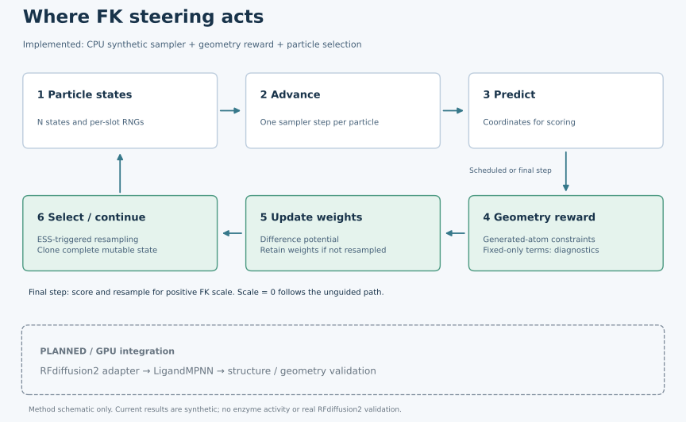
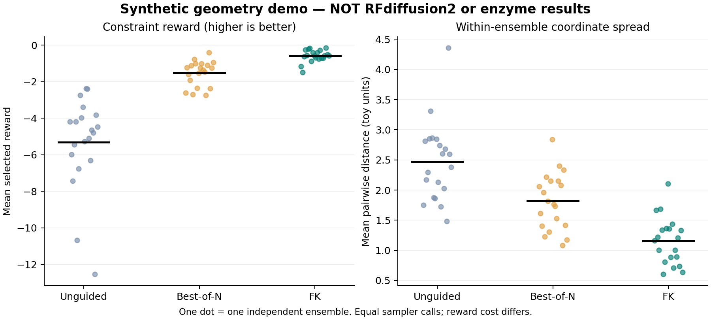

# Theozyme FK Steering

Inference-time Feynman–Kac steering toward catalytic geometry.

This project investigates whether Feynman–Kac (FK) steering can improve catalytic geometry preservation in an RFdiffusion2 + LigandMPNN enzyme design pipeline. The goal is to evaluate a target active-site geometry, or theozyme, during generation and allocate more sampling effort to promising trajectories.

The research question is: can FK steering produce more candidates that retain the target geometry after sequence design and structure prediction than unguided generation or post-hoc selection?

Version 0.1.1 provides CPU geometry rewards, a model-independent FK core, and a synthetic benchmark. Integration with RFdiffusion2 and experiments on real enzyme design tasks remain to be implemented and validated.

[Quickstart](#quickstart) · [Results](#results) · [Method](docs/METHOD.md) · [Development roadmap](docs/NEXT_STEPS.md)

## Implementation status

| Component | Current support |
|---|---|
| Geometry evaluation | Distances, angles, periodic dihedrals, Kabsch alignment, and anchor-based RMSD |
| Theozyme reward | Atom selectors, fixed/generated roles, and geometry penalties with tolerances |
| FK / sequential Monte Carlo | Difference potential, ESS-based systematic resampling, and ancestry tracking |
| CPU benchmark | Unguided, Best-of-N, and FK comparisons with independent ensemble repetitions and plots |
| RFdiffusion2 | Adapter not implemented; a baseline launcher is provided but has not been validated on a GPU |
| Downstream design and prediction | LigandMPNN and structure prediction are not integrated; real enzyme tasks and gradient guidance are not implemented |

## How steering works



Each particle represents a generation state. At scheduled steps, predicted coordinates are scored and particle weights are updated from reward changes. When weights become concentrated on a small number of particles, resampling reallocates the population before generation continues. Best-of-N provides a comparison that selects candidates only after generation finishes.

An RFdiffusion2 adapter must preserve the complete inference state, including coordinates, self-conditioning, caches, and atom assignments. The dashed region in the diagram shows the planned GPU pipeline.

## Quickstart

### 1. Install the CPU environment

Requirements: Git and Python 3.10 or newer. The CPU benchmark does not require CUDA or a GPU. The following commands use a POSIX shell on Linux or macOS; automated checks currently run on Linux.

```bash
git clone https://github.com/ju2501/theozyme_FK_steering.git
cd theozyme_FK_steering
python3 -m venv .venv
source .venv/bin/activate
python -m pip install -e '.[dev,report]'
```

If you already have a checkout, start with environment creation from the repository root. On Windows, use `python` to create the environment and `.venv\Scripts\Activate.ps1` to activate it in PowerShell; Windows execution has not been validated. On Debian or Ubuntu, a missing `venv` or `ensurepip` module may require the `python3-venv` system package.

NumPy is the only core dependency. The `dev` extra adds pytest, and `report` adds matplotlib. Run the commands below from the repository root with the environment activated.

### 2. Check the installation and score a structure

```bash
python -m unittest discover -s tests -v
python -m steer.cli.main score --task configs/theozyme/synthetic.json --pdb tests/fixtures/synthetic.pdb
```

The synthetic PDB fixture should return reward 0, `valid: true`, and `passed: true`. The `valid` field indicates whether scoring succeeded; `passed` indicates whether every geometry constraint is within tolerance. A valid structure that fails its constraints still produces exit code 0, so inspect `passed` when filtering candidates.

### 3. Compare three sampling strategies

```bash
python -m steer.cli.main demo --config configs/runs/toy.json --out runs/first-demo --plot
```

The demo uses three fixed points and one moving point with distance constraints. It is a synthetic algorithm benchmark, not a protein generation model or an enzyme experiment.

| Output | Contents |
|---|---|
| `runs/first-demo/comparison.png` | Reward and coordinate diversity comparison |
| `runs/first-demo/summary.json` | Method averages, pass fractions, and statistics across repetitions |
| `runs/first-demo/replicate_metrics.csv` | Metrics and costs for each independent ensemble |
| `runs/first-demo/selected.csv` | Selected coordinates, rewards, and ancestry |
| `runs/first-demo/manifest.json` | Configuration, task/source hashes, and runtime versions |
| `runs/first-demo/replicates/` | Per-repetition particle pools and FK resampling records |

Use a new `--out` directory for each experiment. To resume an interrupted run, add `--resume` to the same command. Completed ensemble repetitions are reused; resuming partway through a trajectory is not supported. Resume rejects changes to the configuration, task, core source, or Python/NumPy versions. Additional per-checkpoint identity validation needed in v0.1.1 is described in the [development roadmap](docs/NEXT_STEPS.md).

## Results



The recorded [configuration](configs/runs/toy.json) uses 20 independent ensembles, starting at seed 20260924, with 16 particles and 40 steps per ensemble. Each method returns four selected outputs per ensemble.

| Method | Mean reward ↑ | Mean pairwise coordinate distance | All constraints passed / selected outputs | Sampler calls / ensemble |
|---|---:|---:|---:|---:|
| Unguided | −5.3235 | 2.4686 | 0 / 80 | 640 |
| Best-of-N | −1.5335 | 1.8139 | 0 / 80 | 640 |
| FK | −0.5823 | 1.1574 | 1 / 80 | 640 |

FK improved the mean reward on this synthetic task, while coordinate diversity decreased and complete constraint satisfaction remained rare. These results do not establish improved enzyme activity.

- Unguided and Best-of-N share the same baseline pool. All methods return the same number of selected outputs.
- Sampler call counts are matched. FK requires additional reward evaluations, so the comparison does not match wall-clock time.
- FK particles share ancestry. Uncertainty is estimated across the 20 independent ensembles; the 80 selected outputs are not treated as independent experiments.

See [summary.json](results/summary.json) and [manifest.json](results/manifest.json) for the recorded results and provenance, and [EXPERIMENTS.md](docs/EXPERIMENTS.md) for metric definitions.

## Reward and FK conventions

For each constraint, the violation is the error beyond its tolerance, divided by a scale. The reward is the negative weighted mean of squared violations; zero is the best possible reward.

```text
violation_j = max(0, abs(error_j) - tolerance_j) / scale_j
reward = -sum(weight_j * violation_j^2) / sum(weight_j)
```

- Distances are measured in Å; angles and dihedrals are measured in degrees. Dihedral errors wrap across the periodic boundary.
- Only constraints involving generated atoms contribute to the reward. Fixed-only constraints remain part of the diagnostics and overall pass criterion.
- Tasks with only fixed-atom constraints are rejected for steering. Role labels alone do not guarantee a useful signal: reward variation must also be checked on actual predictions.
- Missing atoms and undefined geometry produce invalid scores. An invalid lineage receives zero weight and cannot recover at a later scoring step. If every particle is invalid, the run raises an error.
- Difference-potential log weights accumulate across scoring steps, including steps where resampling is skipped. For positive FK scale, terminal scoring and resampling are mandatory. With `scale=0`, the sampler follows the unguided path.

See [METHOD.md](docs/METHOD.md) for equations and boundary conditions, and the [synthetic task](configs/theozyme/synthetic.json) for atom selector examples. The parser supports PDB; mmCIF and automatic symmetry-aware atom matching are not supported. Distance constraints alone do not establish chirality or catalytic function.

## Configuration and GPU integration

Edit [configs/runs/toy.json](configs/runs/toy.json) to adjust particle count (`num_particles`), repetitions (`replicates`), steering strength (`scale`), scoring interval (`every`), and the ESS threshold (`ess_fraction`). The `start_fraction` and `end_fraction` settings control intermediate scoring and do not disable terminal scoring. Save modified configurations separately and use a new output directory.

The `demo` command uses the synthetic sampler only. Use `score` for static evaluation of mapped PDB atoms. Scoring inside RFdiffusion2 generation requires the planned adapter.

| Environment | Intended use |
|---|---|
| CPU workstation or server | Reward and atom-mapping validation, tests, synthetic experiments, and analysis |
| GPU workstation or cluster | Pinned upstream baseline, adapter validation, and real generation experiments |
| Hosted GPU runtime | Small experiments after confirming the same baseline and environment requirements |

The official RFdiffusion2 evaluation pipeline uses RFdiffusion2 → LigandMPNN → Chai-1. An evaluation based on AF2 would need a separately defined method for assessing ligand-relative geometry. The included [notebook](notebooks/colab_cpu.ipynb) demonstrates the CPU workflow. See [GPU_RUNBOOK.md](docs/GPU_RUNBOOK.md) for GPU preparation and [RFD2_INTEGRATION.md](docs/RFD2_INTEGRATION.md) for the adapter contract.

## Development priorities

1. Experiment reliability: validate checkpoint identities and test installation and execution from release archives.
2. One real task: establish a reference geometry with documented provenance, atom mapping, and coordinate-perturbation checks.
3. RFdiffusion2 adapter: reproduce the baseline, verify intermediate reward variation, clone complete states, and compare zero steering against the baseline.
4. Downstream evaluation: track geometry preservation after generation, LigandMPNN, and structure prediction.
5. Comparative experiments: compare Unguided, Best-of-N, and FK with equal output counts and recorded computational costs.

The [development roadmap](docs/NEXT_STEPS.md) lists completion criteria and suggested work units. Gradient guidance and multiple reaction types are later extensions, after validating the path for a single task.

## Repository guide

| Path | Purpose |
|---|---|
| [`src/steer/geometry/`](src/steer/geometry/) · [`rewards/`](src/steer/rewards/) | Geometry calculations, task definitions, and rewards |
| [`src/steer/particles/`](src/steer/particles/) | FK weights, ESS, and resampling |
| [`src/steer/hooks/`](src/steer/hooks/) | Sampler contract, toy sampler, and RFdiffusion2 adapter boundary |
| [`src/steer/io/`](src/steer/io/) · [`cli/`](src/steer/cli/) | PDB/JSON I/O and command-line entry points |
| [`tests/`](tests/) · [`configs/`](configs/) | Tests, synthetic fixtures, and experiment settings |
| [`pipelines/rfd2/`](pipelines/rfd2/) | Baseline launcher awaiting GPU validation |
| [`docs/`](docs/) · [`DECISIONS.md`](DECISIONS.md) | Methods, development plans, and design decisions; some supporting documents are in Korean |

Validation history is recorded in [BUILD_REPORT.md](docs/BUILD_REPORT.md). Local validation passed 54 unittest tests and the CPU demo on Python 3.12. On 2026-10-11, [GitHub Actions](https://github.com/ju2501/theozyme_FK_steering/actions/runs/38138798702) also passed installation, pytest, synthetic scoring, and the CPU demo on Python 3.10 and 3.12. Bitwise-identical results across operating systems and NumPy versions are not guaranteed.

## References and license

- [FK-RFdiffusion](https://github.com/ErikHartman/FK-RFdiffusion): prior FK steering implementation for RFdiffusion. This project investigates catalytic geometry objectives and integration with RFdiffusion2.
- [RFdiffusion2 documentation](https://rosettacommons.github.io/RFdiffusion2/readme_link.html): baseline examples, output representations, and the LigandMPNN/Chai-1 evaluation pipeline.
- [LigandMPNN](https://github.com/dauparas/LigandMPNN): ligand-aware sequence design and side-chain packing.

Upstream code, model weights, and containers are not bundled. A license for this project's own code has not yet been selected.
